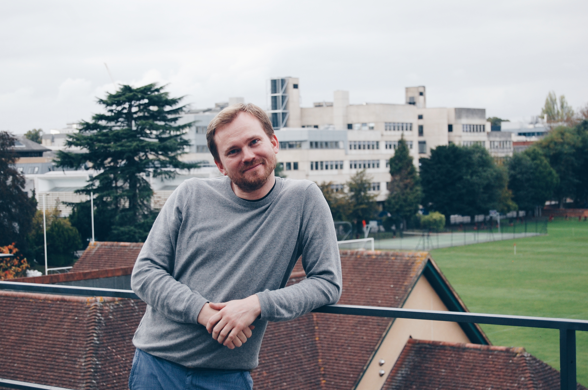

<!------>

I work as a researcher at [Oxford University’s Department of Sociology](https://www.sociology.ox.ac.uk/academic-staff/patrick-praeg.html) and am a Research Fellow at [Nuffield College](https://www.nuffield.ox.ac.uk/people/profiles/patrick-praeg/). I do research on social stratification, social demography, health and wellbeing, and work and family reconciliation. In my work, I mostly use quantitative methods and survey data. I have a PhD from the [ICS/University of Groningen](http://ics-graduateschool.nl/).

Below is a list of my [publications](#publications). If you want to find out more about me and my work, this is my [Google Scholar profile](https://scholar.google.com/citations?user=MW-rFm4AAAAJ). This is my [Open Science Framework](https://osf.io/euzd6/) profile. Follow me on [Twitter](https://twitter.com/ppraeg). This is a collection of [Stata commands I have found useful](http://statafun.blogspot.com/) at some point. This is a [collection of chocolate bar reviews](https://www.instagram.com/schokomonstranz/) I wrote (in German). Find my [contact details](#contact-details) at the bottom of the page.

## Publications
### Working papers

1. Präg, Patrick, Nina-Sophie Fritsch, and Lindsay Richards: “Intragenerational Social Mobility and Wellbeing in Great Britain. A Biomarker Approach,” available if you email me. Replication materials at [OSF](https://osf.io/d6gt8/?view_only=dbf0ec37997f41e9b7668c595a34f9ef).
2. Präg, Patrick, Katia Begall, and Judith Treas: “Understanding the Marriage–Cohabitation Gap in Income Pooling. Evidence from 29 European Countries,” available at [Socarxiv](https://doi.org/10.31235/osf.io/rqzj3). Replication materials at [OSF](https://osf.io/jb6vz/). Coverage at the [Institute for Family Studies](https://ifstudies.org/blog/marriage-still-matters-for-how-couples-share-finances) blog.
3. Grätz, Michael, Kieron Barclay, Øyvind Wiborg, Torkild Lyngstad, Aleksi Karhula, Jani Erola, Patrick Präg, Thomas Laidley, and Dalton Conley: “Universal Family Background Effects on Education Across and Within Societies,” available as [MPIDR Working Paper WP-2019-007](https://www.demogr.mpg.de/en/publications_databases_6118/publications_1904/mpidr_working_papers/universal_family_background_effects_on_education_across_and_within_societies_6196) and [Stockholm Research Reports in Demography 2019-13](https://doi.org/10.17045/sthlmuni.7999148.v1).
4. Paskov, Marii, Patrick Präg, and Lindsay Richards: “Does Downward Social Mobility Make People More Hostile Towards Immigrants?,” available at [Socarxiv](https://doi.org/10.31235/osf.io/yxe7u). Replication materials at [OSF](https://doi.org/10.17605/OSF.IO/TPXBH).
5. Ersanilli, Evelyn, and Patrick Präg: “Fixed-Term Work Contracts and Anti-Immigration Attitudes. A Novel Test of Ethnic Competition Theory,” available at [Socarxiv](https://doi.org/10.31235/osf.io/42xbp). Replication materials at [OSF](https://doi.org/10.17605/OSF.IO/DY6N2). 
6. Maecken, Jana, Patrick Präg, Moritz Hess, and Lea Ellwardt: “Educational Inequalities in Labor Market Exit of Older Workers in 15 European Countries,” available if you email me. 
7. Präg, Patrick: “Subjective Socioeconomic Status Predicts Self-Rated Health Irrespective of Objective Family Socioeconomic Background,” available if you email me. Replication materials at [OSF](https://osf.io/32pc8).
8. Potente, Cecilia, Patrick Präg, and Christiaan Monden: “Does Children’s Education Affect Parental Health and Mortality? A Regression Discontinuity Approach with Linked Census Data from England and Wales,” available at [Socarxiv](https://doi.org/10.31235/osf.io/eah4w). Replication materials at [OSF](https://osf.io/39wc5/).
9. Präg, Patrick, Seongsoo Choi, and Christiaan Monden: “Sibship Size in Low-Fertility Countries over the Twentieth Century: Declining Social Disparities,” available at [Socarxiv](https://doi.org/10.31235/osf.io/zvb9c). Replication materials at [OSF](https://osf.io/vr93g/).

### Journal articles

1. Präg, Patrick, and Lindsay Richards, 2019: “Intergenerational Social Mobility and Allostatic Load in Great Britain,” _Journal of Epidemiology and Community Health_ 73(2), pp. 100–105. (Lead article, “chosen by the editor to be of special interest or importance.”) Available at [Socarxiv](https://doi.org/10.31235/osf.io/63arn) and the [publisher website](https://doi.org/10.1136/jech-2017-210171). Replication materials at [OSF](https://osf.io/296jc/). Writeup at [The Conversation](https://theconversation.com/being-born-working-class-is-bad-for-your-health-and-moving-up-the-social-ladder-cannot-compensate-for-it-105245).
2. Präg, Patrick, 2019: “Visualizing Individual Outcomes of Social Mobility Using Heatmaps,” _Socius_ 5, pp. 1–2, available at [Socarxiv](https://doi.org/10.31235/osf.io/4dwzc) and the [publisher website](https://doi.org/10.1177/2378023119855486). Replication materials at [OSF](https://osf.io/ky9ux/).
3. Barbara Beham, Sonja Drobnič, Patrick Präg, Andreas Baierl, and Janin Eckner, 2019: “Part-Time Work and Gender Inequality in Europe. A Comparative Analysis of Satisfaction with Work–Life Balance,” _European Societies_ 21(3), pp. 378–402. Available at [Socarxiv](https://doi.org/10.31235/osf.io/scpx6) and the [publisher website](https://doi.org/10.1080/14616696.2018.1473627).
4. Präg, Patrick and Melinda Mills, 2017: “Cultural Determinants Influence Assisted Reproduction Usage in Europe More than Economic and Demographic Factors,” _Human Reproduction_ 32(11), pp. 2305–2314. Available at [Socarxiv](https://doi.org/10.31235/osf.io/tcj94) and the [publisher website](https://doi.org/10.1093/humrep/dex298). Replication materials and data at [OSF](https://doi.org/10.17605/OSF.IO/Q5H6X). [Press release](http://www.ox.ac.uk/news/2017-10-06-religion-and-social-factors-top-ivf-concerns).
5. Präg, Patrick, Rafael Wittek, and Melinda Mills, 2017: “The Educational Gradient in Self-Rated Health in Europe. Does the Doctor–Patient Relationship Make a Difference?,” _Acta Sociologica_ 60(4), pp. 325–341. Available at [Socarxiv](https://doi.org/10.31235/osf.io/mv7mf) and the [publisher website](https://doi.org/10.1177/0001699316670715). Replication materials at [OSF](https://doi.org/10.17605/OSF.IO/B4MP2).
6. Beham, Barbara, Sonja Drobnič, Patrick Präg, Andreas Baierl, and Suzan Lewis, 2017: “Work-to-Family Enrichment and Gender Inequalities in Eight European Countries,” _International Journal of Human Resource Management_. Available at [Socarxiv](https://doi.org/10.31235/osf.io/vzphs) and the [publisher website](https://doi.org/10.1080/09585192.2017.1355837).
7. Präg, Patrick, and SV Subramanian, 2017: “Educational Inequalities in Self-Rated Health across US States and European Countries,” _International Journal of Public Health_ 62(6), pp. 709–716. Available at [Socarxiv](https://doi.org/10.31235/osf.io/vm2zp) and the [publisher website](https://doi.org/10.1007/s00038-017-0981-6). Replication materials at [OSF](https://doi.org/10.17605/OSF.IO/6CMJT). [Blog post](http://blogs.springer.com/ijph/hot-off-the-press/health-inequalities/) about the article.
8. Präg, Patrick, Melinda Mills, and Rafael Wittek, 2016: “Subjective Socioeconomic Status and Health in Cross-National Comparison,” _Social Science and Medicine_ 149, pp. 84–92. Available at [Socarxiv](https://doi.org/10.31235/osf.io/fpdcb) and the [publisher website](https://doi.org/10.1016/j.socscimed.2015.11.044). Replication materials at [OSF](https://doi.org/10.17605/OSF.IO/UATH5). Received the Aage B. Sørensen Award at the 2014 RC28 Spring Meeting in Budapest.
9. Mills, Melinda, and Patrick Präg, 2016: “Methodological Advances in Cross-National Research. Multilevel Challenges and Solutions,” _European Sociological Review_ 32(1), pp. 1–2. Available at [Socarxiv](https://doi.org/10.31235/osf.io/f25ja) and the [publisher website](https://doi.org/10.1093/esr/jcw009).
10. Präg, Patrick, Melinda Mills, and Rafael Wittek, 2014: “Income and Income Inequality as Social Determinants of Health. Do Social Comparisons Play a Role?,” _European Sociological Review_ 30(2), pp. 218–229. Available at [Socarxiv](https://doi.org/10.31235/osf.io/2wky8) and the [publisher website](https://doi.org/10.1093/esr/jct035).
11. Ellwardt, Lea, Sascha Peter, Patrick Präg, and Nardi Steverink, 2014: “Social Contacts of Older People in 27 European Countries. The Role of Welfare Spending and Economic Inequality,” _European Sociological Review_ 30(4), pp. 413–430. Available at the [publisher website](https://doi.org/10.1093/esr/jcu046).
12. Beham, Barbara, Sonja Drobnič, and Patrick Präg, 2014: “The Work–Family Interface of Service Sector Workers. A Comparison of Work Resources and Professional Status Across Five European Countries,” _Applied Psychology_ 63(1), pp. 29–61. Available at [Socarxiv](https://doi.org/10.31235/osf.io/645ft) and at the [publisher website](https://doi.org/10.1111/apps.12012).
13. Beham, Barbara, Patrick Präg, and Sonja Drobnič, 2012: “Who’s got the Balance? A Study of Satisfaction with the Work–Family Balance among Part-Time Service Sector Employees in Five Western European Countries,” _International Journal of Human Resource Management_ 23(18), pp. 3725–3741. Available at [Socarxiv](https://doi.org/10.31235/osf.io/wak9y) and the [publisher website](https://doi.org/10.1080/09585192.2012.654808).
14. Beham, Barbara, Sonja Drobnič, and Patrick Präg, 2011: “Work Demands and Resources and the Work–Family Interface. Testing a Salience Model on German Service Sector Employees,” _Journal of Vocational Behavior_ 78(1), pp. 110–122. Available at [Socarxiv](https://doi.org/10.31235/osf.io/2jva4) and the [publisher website](https://doi.org/10.1016/j.jvb.2010.07.008).
15. Drobnič, Sonja, Barbara Beham, and Patrick Präg, 2010: “Good Job, Good Life? Working Conditions and Quality of Life in Comparative Perspective,” _Social Indicators Research_ 99(2), pp. 205–225. Available at the [publisher website](https://doi.org/10.1007/s11205-010-9586-7).

### Book chapters
1. Präg, Patrick, and Melinda Mills, 2017: “Assisted Reproductive Technologies in Europe. Usage and Regulation in the Context of Cross-Border Reproductive Care,” pp. 289–309 in _Childlessness in Europe. Contexts, Causes, and Consequences_, edited by Michaela Kreyenfeld and Dirk Konietzka. Springer. Available at [Socarxiv](https://doi.org/10.31235/osf.io/6pb7z) and the [publisher website](https://doi.org/10.1007/978-3-319-44667-7_14). Replication materials at [OSF](https://doi.org/10.17605/OSF.IO/7U2N4).
2. Präg, Patrick, and Melinda Mills, 2014: “Family-Related Work Schedule Flexibility in Europe,” pp. 360–420 in _Gender Equality in the Workforce. Reconciling Work, Private, and Family Life in Europe_, edited by European Commission DG Justice. Publications Office of the European Union. Available at the [Publications Office of the European Union](https://doi.org/10.2838/54302) and at [RAND](https://www.rand.org/pubs/research_reports/RR365.html).
3. Mills, Melinda, and Patrick Präg, 2014: “Gender Inequalities in the School-to-Work Transition in Europe,” pp. 229–313 in _Gender Equality in the Workforce. Reconciling Work, Private, and Family Life in Europe_, edited by European Commission DG Justice. Publications Office of the European Union. Available at the [Publications Office of the European Union](https://doi.org/10.2838/54302) and at [RAND](https://www.rand.org/pubs/research_reports/RR363.html).
4. Mills, Melinda, Patrick Präg, Flavia Tsang, Katia Begall, James Derbyshire, Laura Kohle, and Stijn Hoorens, 2014: “Use of Childcare Services in the EU Member States and Progress towards the Barcelona Targets,” pp. 58–128 in _Gender Equality in the Workforce. Reconciling Work, Private, and Family Life in Europe_, edited by European Commission DG Justice. Publications Office of the European Union. Available at the [Publications Office of the European Union](https://doi.org/10.2838/54302) and at [RAND](https://www.rand.org/pubs/research_reports/RR185.html).
5. Mills, Melinda, Flavia Tsang, Patrick Präg, Kai Ruggeri, Celine Miani, and Stijn Hoorens, 2014. “Gender Equality in the Workforce,” pp. 1–57 in _Gender Equality in the Workforce. Reconciling Work, Private, and Family Life in Europe_, edited by European Commission DG Justice. Publications Office of the European Union. Available at the [Publications Office of the European Union](https://doi.org/10.2838/54302) and at [RAND](https://www.rand.org/pubs/research_reports/RR462.html).
6. Drobnič, Sonja, Barbara Beham, and Patrick Präg. 2014. “Working Conditions in Europe,” pp. 7221–7226 in _Encyclopedia of Quality of Life and Wellbeing Research_, edited by Alex C. Michalos. Springer. Available at [Socarxiv](https://doi.org/10.31235/osf.io/493ev) and the [publisher website](https://doi.org/10.1007/978-94-007-0753-5_4008).
7. Präg, Patrick, Maria das Dores Guerreiro, Jouko Nätti, Michael Brookes, and Laura den Dulk, 2011: “Quality of Work and Quality of Life of Service Sector Workers. Cross-National Variation in Eight European Countries,” pp. 77–94 in _Quality of Work and Life. Theory, Practice, and Policy_, edited by Margareta Bäck-Wiklund, Tanja van der Lippe, Laura den Dulk, and Anneke van Doorne-Huiskes. Palgrave Macmillan. Available at [Socarxiv](https://doi.org/10.31235/osf.io/fcd6w) and the [publisher website](https://doi.org/10.1057/9780230299443_5).
8. Präg, Patrick, Steffen Mau, and Roland Verwiebe, 2010: “Quality of Life,” pp. 225–260 in _European Societies. Mapping Structure and Change_, by Steffen Mau and Roland Verwiebe. Policy Press. Revised and updated English-language version of Präg et al. (2009). Available at [Socarxiv](https://doi.org/10.31235/osf.io/a8qhf), [JSTOR](https://doi.org/10.2307/j.ctt1t89j6j.16), and at a [library near you](http://www.worldcat.org/oclc/934394945). Replication materials at [OSF](https://doi.org/10.17605/OSF.IO/KMTW9).
9. Beham, Barbara, Patrick Präg, and Sonja Drobnič, 2010: “Balance zwischen Erwerbstätigkeit und Familienleben. Eine vergleichende Studie unter Eltern in vier europäischen Ländern” (Work–life balance:  A comparative study among parents in four European countries), pp. 81–104 in _Die Metropolregion Berlin vor demografischen und gesellschaftlichen Herausforderungen_, edited by Matthias Schmidt and Christoph Schank, Munich: Hampp. Available at [Socarxiv](https://doi.org/10.31235/osf.io/vq4ek) or a [library near you](http://www.worldcat.org/oclc/1014391123).
10. Präg, Patrick, Steffen Mau, and Roland Verwiebe, 2009: “Lebensqualität” [Quality of life], pp. 203-232 in _Die Sozialstruktur Europas_, by Steffen Mau and Roland Verwiebe, UVK. Reprinted by the German Federal Agency for Civic Education in 2009. Available at a [library near you](http://www.worldcat.org/oclc/699762485).

### Project reports

1. Präg, Patrick, Tomáš Sobotka, Eevi Lappalainen, Anneli Miettinen, Anna Rotkirch, Judit Takács, Annalisa Donno, Maria Letizia Tanturri, and Melinda Mills, 2016: _Childlessness and Assisted Reproduction in Europe_. Deliverable for the ‘Families and Societies’ project. Available at [Socarxiv](https://doi.org/10.31235/osf.io/sxgu4). 
2. Präg, Patrick, Melinda Mills, Maria Letizia Tanturri, Christiaan Monden, and Gilles Pison, 2015: _The Demographic Consequences of Assisted Reproductive Technologies_. Deliverable for the ‘Families and Societies’ project. Available at [Socarxiv](https://doi.org/10.31235/osf.io/su49v). 

### Theses

1. Präg, Patrick: _Social Stratification and Health. Four Essays on the Social Determinants of Health and Wellbeing_, doctoral thesis, ICS/University of Groningen. Available at [Socarxiv](https://doi.org/10.31235/osf.io/3rn8m) or at a [library not near you](http://www.worldcat.org/oclc/920497426).
2. Präg, Patrick: _Nonresponse to Items on Self-Reported Delinquency.  A Review and Evaluation of Missing Data Techniques_, master thesis, University of Hamburg. [Available at Socarxiv](https://doi.org/10.31235/osf.io/y9sv7).

## Contact details

<iframe src="https://www.google.com/maps/embed?pb=!1m18!1m12!1m3!1d2469.9240054992815!2d-1.2667738841851541!3d51.75271317967623!2m3!1f0!2f0!3f0!3m2!1i1024!2i768!4f13.1!3m3!1m2!1s0x4876c757ec7e4397%3A0x32ecdfb733280012!2sDepartment%20of%20Sociology!5e0!3m2!1sen!2suk!4v1580262564540!5m2!1sen!2suk" width="400" height="300" frameborder="0" style="border:0;" allowfullscreen="" align="right"></iframe>

patrick.prag@sociology.ox.ac.uk

Patrick Präg

Department of Sociology, University of Oxford

42–3 Park End Street

Oxford OX1 1JD, United Kingdom

